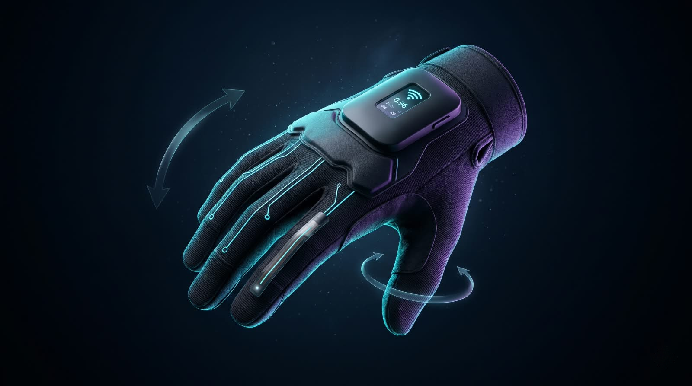
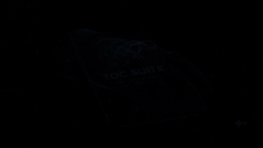
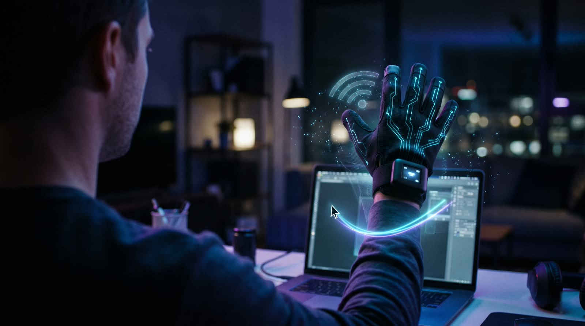
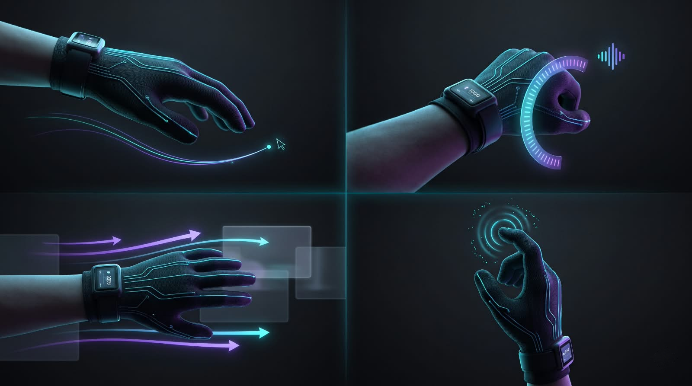
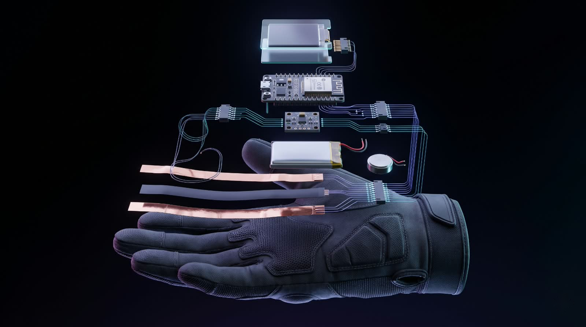
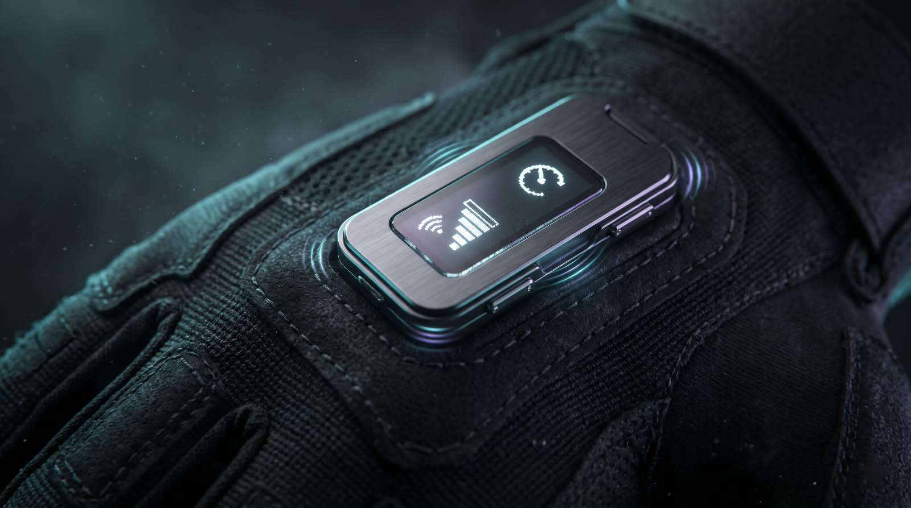
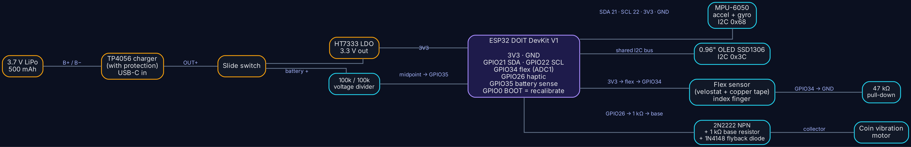
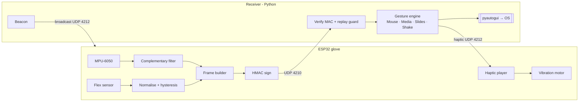

<div align="center">



 🧤 Omni-Gauntlet

### A wireless gesture-control glove — ESP32 + MPU-6050 + flex sensor streaming signed UDP frames to a Python receiver that drives your mouse, media and slides

   

[](LICENSE)    

[](https://codespaces.new/shiroonigami23-ui/Omni-Gauntlet?quickstart=1) [](https://github.com/shiroonigami23-ui/Omni-Gauntlet/archive/refs/heads/main.zip)

[**Overview**](#-overview) · [**Features**](#-features) · [**Architecture**](#-architecture) · [**Getting Started**](#-getting-started) · [**Roadmap**](#-roadmap)

</div>

---

<p align="center"><a href="assets/trailer.mp4"></a><br><sub>Concept trailer · <a href="assets/trailer.mp4">watch with sound (MP4)</a></sub></p>

<p align="center"> </p>

## 📖 Overview

**Omni-Gauntlet** turns an ordinary glove into a programmable input device. An **ESP32** on the back of the hand fuses an **MPU-6050** accelerometer and gyroscope into hand orientation, reads a DIY **velostat flex sensor** on the index finger, and streams ~66 frames per second over **Wi-Fi UDP** — lower latency and longer range than Bluetooth. A small **Python receiver** turns those frames into actions: tilt to move the cursor, bend your finger to click, twist your wrist like a doorknob to change volume, swipe to change slides, and shake to hide everything on screen.

Every packet is **signed with a shared pairing key (HMAC-SHA256)** and protected against replay, the glove **finds your computer automatically** via signed broadcast beacons, and the receiver sends **haptic feedback** back to the glove's vibration motor. No glove yet? `omni-receiver simulate` runs the whole gesture set with a software glove.

### ✨ Highlights

- **Four modes in one hand** — Mouse, Media, Presentation, plus a global shake-to-hide "Hacker Mode"
- **Secure by default** — HMAC-signed frames + replay protection; strangers on your Wi-Fi can't drive your PC
- **Zero configuration networking** — the glove discovers the receiver from its broadcast beacon
- **Two-way haptics** — clicks, mode changes and alerts buzz back on the glove
- **Hardware-free development** — simulator, 30 Python tests and 47 firmware-core checks run in CI
- **About ₹1,500** of parts (BOM in [docs/HARDWARE.md](docs/HARDWARE.md))

## 🧩 Features

| Feature | What it does |
|---|---|
| **Mouse mode** | Tilt = cursor with dead zone, exponential curve and smoothing; quick bend = left click (cursor freezes while bent so you don't miss); hold bend 0.8 s = right click |
| **Media mode** | Twist the wrist (roll rate) = volume up/down; bend = play/pause |
| **Presentation mode** | Quick sideways swipe (yaw rate) = next/previous slide; bend = next slide |
| **Mode switch** | Hold the hand upright + bend the finger; the glove buzzes 1/2/3 pulses and shows the mode on the OLED |
| **Hacker Mode** | Violent shake (>2.6 g) from any mode = show desktop / minimise (Win+D, Super+D, Cmd+M) |
| **Calibration** | Gyro bias, neutral pose and flex range at boot; press BOOT to recalibrate any time |
| **Security** | HMAC-SHA256 (128-bit tag) on every datagram; per-boot replay guard |
| **Auto-discovery** | Signed UDP broadcast beacons to the glove (port 4212), or a fixed `HOST_IP` for networks that block broadcast; host forgotten after 5 s of silence |
| **OLED status** | Mode, Wi-Fi RSSI, host name, battery % and live flex level |
| **Simulator** | `omni-receiver simulate` streams a scripted gesture tour through the real protocol |

## 🔬 Inside the Gauntlet

<table><tr>
<td width="50%" align="center"><br><sub><b>Exploded view</b> — LiPo, ESP32, MPU-6050, flex strips, haptic motor</sub></td>
<td width="50%" align="center"><br><sub><b>Wrist module</b> — OLED status and haptic feedback</sub></td>
</tr></table>

Wiring, parts list, pin choices, power budget and how to make the velostat flex sensor: **[docs/HARDWARE.md](docs/HARDWARE.md)**.

<p align="center"></p>

> The renders are concept art for the planned build; the code in this repo is real and tested (simulator + CI).

## 🛡️ What changed from the original design

The project started as a December 2025 design document ([original-design-dec-2025.pdf](docs/original-design-dec-2025.pdf)). v0.2 keeps its ideas and fixes what review found:

| Original (v0.1) | v0.2 |
|---|---|
| Any device on the Wi-Fi could send packets and control the PC | HMAC-signed frames + replay guard + signed beacons |
| Laptop IP hard-coded in the firmware | Automatic discovery via broadcast beacon |
| Cursor from raw accelerometer values, jittery | Complementary filter, calibration, dead zone, expo curve, smoothing |
| "Hacker Mode" in the manual but not in the code | Implemented (shake > 2.6 g, per-OS hotkey) |
| Motor driven straight from GPIO26 (~70 mA > safe pin current) | Transistor driver + flyback diode |
| No charger, switch or regulator | TP4056 with protection, slide switch, 3.3 V LDO |
| Vibration only at boot | Two-way haptics for clicks, modes and alerts |
| pyautogui fail-safe disabled | Fail-safe on, glove moves clamped off the corners, pause instead of crash |
| Left click fired on the first frame of a bend | Click on release, cursor frozen while bent, long hold = right click |
| No tests | 30 Python tests, 47 firmware-core checks, PlatformIO build in CI |

## 🛠 Tech Stack

| Layer | Technology |
|---|---|
| Firmware | ESP32 Arduino (PlatformIO), Adafruit MPU6050 + SSD1306, own SHA-256/HMAC |
| Sensing | Complementary filter (α = 0.98), flex normalisation with hysteresis |
| Transport | UDP over Wi-Fi, JSON body + HMAC tag, broadcast discovery |
| Receiver | Python 3.11+ standard library; pyautogui for OS control |
| Tests / CI | pytest, host-compiled C++ checks, PlatformIO build in GitHub Actions |

## 🏗 Architecture

The glove senses and signs; the receiver verifies, interprets gestures and acts — with beacons and haptics flowing back.



➡️ Full design notes, data flow and design decisions: **[docs/ARCHITECTURE.md](docs/ARCHITECTURE.md)**

## 📁 Project Structure

```text
Omni-Gauntlet/
├── firmware/                 # ESP32 (PlatformIO)
│   ├── platformio.ini
│   ├── include/config.h      # pins, ports, thresholds
│   ├── include/secrets.example.h
│   ├── lib/omni_core/        # hardware-independent: SHA-256/HMAC, filters, flex, haptics, framing
│   ├── src/main.cpp          # sensors, Wi-Fi, discovery, calibration, OLED
│   └── test/                 # host unit tests for omni_core (make -C firmware/test)
├── receiver/                 # Python package `omni-receiver`
│   ├── omni_receiver/        # protocol, motion, gestures, actions, server, simulator, cli
│   └── tests/                # pytest: protocol, motion, gestures, end-to-end over UDP
├── docs/HARDWARE.md          # BOM, pin map, flex-sensor build, power budget
├── docs/original-design-dec-2025.pdf
└── assets/                   # renders + wiring diagram
```

## 🚀 Getting Started

### Prerequisites

- Hardware: ESP32 DevKit V1, MPU-6050, flex sensor, vibration motor, LiPo + TP4056 (full list in docs/HARDWARE.md)
- PlatformIO (VS Code extension or `pip install platformio`) to flash the glove
- Python 3.11+ on the computer you want to control

### 1. Get the code

Pick whichever method suits you:

| Method | Command |
|---|---|
| **HTTPS** | `git clone https://github.com/shiroonigami23-ui/Omni-Gauntlet.git` |
| **SSH** | `git clone git@github.com:shiroonigami23-ui/Omni-Gauntlet.git` |
| **GitHub CLI** | `gh repo clone shiroonigami23-ui/Omni-Gauntlet` |
| **ZIP** | [Download](https://github.com/shiroonigami23-ui/Omni-Gauntlet/archive/refs/heads/main.zip) and extract |
| **Codespaces** | [Open in browser](https://codespaces.new/shiroonigami23-ui/Omni-Gauntlet?quickstart=1) — zero local setup, dev container preconfigured |

> 🔑 **Using SSH for the first time?** Generate a key with `ssh-keygen -t ed25519 -C "you@example.com"`, add the `.pub` contents at **GitHub → Settings → SSH and GPG keys**, then test with `ssh -T git@github.com`.

### 2. Install & set up

```bash
cd Omni-Gauntlet
# 1. Receiver (on your computer)
cd receiver
pip install -e ".[control]"
omni-receiver keygen            # prints the pairing key for the firmware

# 2. Firmware (glove)
cd ../firmware
cp include/secrets.example.h include/secrets.h   # set Wi-Fi + the key from step 1
pio run -t upload && pio device monitor
```

### 3. Run

- Start the receiver: `omni-receiver run` (add `--dry-run` to print actions instead of performing them).
- Power the glove, keep your hand flat and still for 1 s, then bend and relax your index finger when the OLED asks.
- Two buzzes = the glove found your computer. Tilt to move the cursor.
- No hardware yet? `omni-receiver simulate --demo-key` runs every gesture through the real protocol.
- **Windows:** allow Python through the firewall for UDP 4210 when prompted (or the glove's frames never arrive).
- **Direction reversed?** Flip `PITCH_SIGN` / `ROLL_SIGN` / `TWIST_SIGN` / `SWIPE_SIGN` in `firmware/include/config.h` to match how you mounted the sensor.
- **Network blocks broadcast** (some campus/guest Wi-Fi)? Set `HOST_IP` in `secrets.h` to your computer's IP.

## 🎮 Usage

| Gesture | Mouse | Media | Presentation |
|---|---|---|---|
| Tilt hand | Move cursor | — | — |
| Quick bend of index finger | Left click (on release) | Play / pause | Next slide |
| Hold bend 0.8 s | Right click | — | — |
| Twist wrist (doorknob) | — | Volume up / down | — |
| Quick sideways swipe | — | — | Next / previous slide |
| Hand upright + bend | Next mode | Next mode | Next mode |
| Violent shake | Show desktop | Show desktop | Show desktop |

> ⚠️ The receiver controls your real mouse and keyboard. Glove moves stay 1 px inside the screen edges; slam the *real* mouse into a corner to trigger the fail-safe, which pauses glove control for 3 s. Only run it with a key you generated yourself.

## ⚙️ Configuration

`~/.config/omni-gauntlet/receiver.toml` (created by `omni-receiver keygen`):

```toml
key = "<32 hex chars, same as OMNI_KEY in firmware/include/secrets.h>"
name = "my-laptop"

[gestures]
upright_deg = 60.0      # how upright the hand must be for the mode gesture
twist_rate_dps = 120.0  # wrist twist speed for volume
swipe_rate_dps = 180.0  # swipe speed for slides
shake_g = 2.6           # shake strength for Hacker Mode

[gestures.cursor]
deadzone_deg = 6.0
gain = 0.25
expo = 1.6
smoothing = 0.35
```

Firmware pins, ports and thresholds live in `firmware/include/config.h`.

## 🗺 Roadmap

**Phase 1 — Prototype (Dec 2025, done)**

- [x] Original design: ESP32 + MPU-6050 + flex + OLED, UDP JSON, pyautogui receiver (docs/original-design-dec-2025.pdf)

**Phase 2 — Solid software (v0.2, done)**

- [x] HMAC-signed frames, replay guard, signed discovery beacons
- [x] Complementary filter, calibration, flex hysteresis, two-way haptics
- [x] Cursor dead zone + expo curve + smoothing; right click; Hacker Mode implemented
- [x] Simulator, unit + end-to-end tests, firmware-core host tests, CI with PlatformIO build
- [x] Safer hardware: TP4056, LDO, switch, transistor motor driver

**Phase 3 — First glove build**

- [ ] Assemble the v0.2 BOM on a glove; tune thresholds on real data
- [ ] Measure end-to-end latency (glove timestamp → action) and battery life
- [ ] Record a demo video and replace concept renders with real photos

**Phase 4 — More fingers, more gestures**

- [ ] Flex sensors on index + middle + thumb (scroll, drag, middle click)
- [ ] Gesture recorder + small ML classifier (custom gestures, on-device TinyML later)
- [ ] Per-app profiles (e.g. VLC, PowerPoint, games)

**Phase 5 — Product-grade**

- [ ] ESP-NOW to a USB dongle that appears as a standard HID mouse (no receiver software, works on any PC)
- [ ] BLE HID mode for phones and tablets
- [ ] Custom PCB + 3D-printed wrist pod; deep sleep when idle

➡️ Detailed plan, milestones and long-term vision: **[docs/ROADMAP.md](docs/ROADMAP.md)**

## 🤝 Contributing

Contributions, issues and feature requests are welcome!

1. Fork the repository
2. Create a feature branch: `git checkout -b feature/amazing-feature`
3. Commit your changes: `git commit -m "feat: add amazing feature"`
4. Push the branch: `git push origin feature/amazing-feature`
5. Open a Pull Request against `main`

Check the [issues page](https://github.com/shiroonigami23-ui/Omni-Gauntlet/issues) and the [roadmap](docs/ROADMAP.md) for ideas on where to help.

## 📜 Changelog

See [CHANGELOG.md](CHANGELOG.md) for the release history.

## 📄 License

Distributed under the **MIT** license. See [LICENSE](LICENSE) for details.

## 👤 Author

**Aryan Singh Chandel** (Shiro)

[](https://github.com/shiroonigami23-ui)

<div align="center">

⭐ **If you find this project useful, consider giving it a star!** ⭐

</div>
