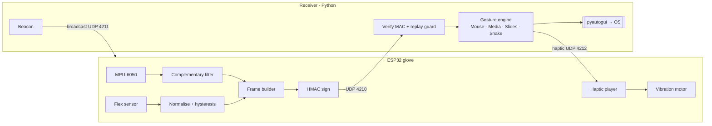

# 🏗 Architecture — Omni-Gauntlet

> Part of [Omni-Gauntlet](https://github.com/shiroonigami23-ui/Omni-Gauntlet). Back to the [README](../README.md).

## 1. System Overview

The glove does the time-critical sensing (filtering, calibration, debouncing) and signs every frame. The receiver is stateless about hardware: it verifies, rejects replays, and runs a small gesture state machine. Discovery beacons and haptic requests flow back the other way, so the glove never needs the computer's IP address.

## 2. Components

| Component | Location | Responsibility |
|---|---|---|
| **omni_core** | `firmware/lib/omni_core` | SHA-256/HMAC, attitude filter, flex hysteresis, haptic patterns, framing (host-testable) |
| **Firmware app** | `firmware/src/main.cpp` | Sensors, Wi-Fi, discovery, calibration, OLED, loop timing |
| **Protocol** | `receiver/omni_receiver/protocol.py` | Encode/verify datagrams, ImuFrame, ReplayGuard |
| **Gesture engine** | `receiver/omni_receiver/gestures.py` | Modes, click/right-click, twist, swipe, shake, mode switch |
| **Cursor mapper** | `receiver/omni_receiver/motion.py` | Dead zone, expo curve, EMA smoothing, sub-pixel accumulation |
| **Server / CLI** | `receiver/omni_receiver/server.py, cli.py` | UDP loop, beacons, haptics, keygen/run/simulate |

## 3. Data / Control Flow

1. The glove boots, connects to Wi-Fi, calibrates, and listens on UDP 4212.
2. The receiver broadcasts a signed beacon every second; the glove verifies it and learns the host IP and port.
3. Every 15 ms the glove sends a signed frame (pitch, roll, roll rate, yaw rate, |a|, flex, click).
4. The receiver verifies the MAC, checks sequence and boot id, and feeds the gesture engine.
5. Actions go to the OS through pyautogui; haptic patterns go back to the glove.

## 4. Key Design Decisions

| Decision | Rationale |
|---|---|
| UDP over Wi-Fi, not Bluetooth | Lower latency and longer range; losing a frame is harmless at 66 Hz |
| HMAC with a shared key | The original design accepted commands from anyone on the network; a signed packet is the minimum for a device that controls a PC |
| Own SHA-256 in omni_core | Identical code on the ESP32 and the host tests; cross-checked against Python's hmac |
| Angles + rates, not raw accel | Tilt for steady cursor control; rates for quick gestures (twist, swipe) that shouldn't move the cursor |
| Gesture logic on the host | Easy to tune and test without reflashing; the glove stays simple |

## 5. Known Limitations

- Hardware not yet assembled; thresholds are simulator-tuned
- pyautogui volume and media keys depend on the OS and desktop
- Replay guard state is in memory (a receiver restart forgets past boot ids)
- No encryption, only authentication (frames contain motion data, not secrets)

---
*Last updated: 2026-11-14*
