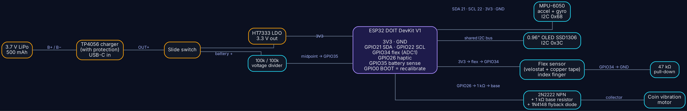

# Hardware Guide



## Bill of materials (Indian market, est. INR)

| Part | Spec | Qty | Est. ₹ | Notes |
|---|---|---|---|---|
| Microcontroller | ESP32 DOIT DevKit V1 | 1 | 450 | Any ESP32 dev board works; adjust pins in `firmware/include/config.h` |
| Motion sensor | MPU-6050 (gyro + accel) breakout | 1 | 160 | I2C 0x68 |
| Display | 0.96" I2C OLED (SSD1306) | 1 | 220 | I2C 0x3C, optional; the firmware runs without it |
| Battery | 3.7 V LiPo, 500 mAh | 1 | 350 | ~3 h with Wi-Fi always on (see power budget) |
| Charger | TP4056 module **with protection** (DW01) | 1 | 40 | **New in v0.2.** Safe USB charging and over-discharge cut-off |
| Regulator | HT7333 (or MCP1700-3302) LDO | 1 | 15 | **New.** Clean 3.3 V from the LiPo; the DevKit's AMS1117 needs ~4.3 V in |
| Power switch | SPDT slide switch | 1 | 10 | **New.** Turn the glove off without unplugging |
| Haptics | Coin vibration motor | 1 | 50 | |
| Motor driver | 2N2222 NPN + 1 kΩ + 1N4148 | 1 set | 10 | **New.** The motor draws ~70 mA, too much for a GPIO pin directly |
| Flex sensor | DIY velostat + copper tape | 1 sheet | 150 | Or a commercial 2.2" flex sensor (~₹350) |
| Battery sense | 2 × 100 kΩ | 2 | 2 | **New, optional.** Lets the OLED show battery % |
| Passives / wire | 47 kΩ, hook-up wire, heat-shrink | set | 50 | |
| Glove | Any snug fabric or tactical glove | 1 | — | Already owned |
| **Total** | | | **≈ ₹1,507** | v0.1 was ₹1,430; the extra ~₹77 makes it safe and switchable |

## Pin map

| ESP32 pin | Connects to | Why this pin |
|---|---|---|
| 3V3 / GND | MPU-6050, OLED, flex sensor top | 3.3 V logic everywhere |
| GPIO 21 (SDA) | MPU-6050 SDA, OLED SDA | Default I2C |
| GPIO 22 (SCL) | MPU-6050 SCL, OLED SCL | Default I2C |
| GPIO 34 | Flex sensor + 47 kΩ to GND | ADC1, so it still works while Wi-Fi is on (ADC2 doesn't) |
| GPIO 26 | 1 kΩ → 2N2222 base | Drives the motor through a transistor |
| GPIO 35 | 100k/100k divider midpoint | ADC1, input-only: perfect for sensing |
| GPIO 0 | On-board BOOT button | Press to recalibrate at any time |

## Building the flex sensor

1. Cut a strip of velostat about 8 cm × 1.2 cm.
2. Stick copper tape on both sides of it (top and bottom), offset so the two copper layers never touch directly.
3. Solder a wire to each copper layer, then wrap the stack in electrical tape or heat-shrink.
4. Stitch or glue it along the back of the index finger.
5. Wire it as the top half of a voltage divider: **3V3 → sensor → GPIO 34**, with **47 kΩ from GPIO 34 to GND**.

Bending compresses the velostat, its resistance drops, and the voltage on GPIO 34 rises. The firmware calibrates both ends (straight and bent) at boot, so the exact values don't matter, and it works even if you wire it the other way round.

## Motor driver

```
GPIO26 ──[1 kΩ]──► base (2N2222)
3V3 ──► motor + ; motor − ──► collector ; emitter ──► GND
1N4148 across the motor (cathode to +) to absorb the motor's voltage spike
```

## Power budget

| Consumer | Typical current |
|---|---|
| ESP32 with Wi-Fi active, modem sleep off (lowest latency) | 110–160 mA |
| MPU-6050 | 4 mA |
| OLED (mostly dark UI) | 10–20 mA |
| Vibration motor (short pulses) | ~70 mA while buzzing; small on average |
| **Total** | **≈ 130–180 mA** |

500 mAh ÷ ~160 mA ≈ **3 hours** of continuous use. Options for more: a 1000 mAh cell (~6 h), enabling Wi-Fi modem sleep (more latency), or the ESP-NOW + USB dongle design on the roadmap.

## Mounting tips

- Put the ESP32, battery and charger in a small pouch or 3D-printed case on the **back of the hand or the wrist**, never the palm.
- Mount the MPU-6050 **flat on the back of the hand**, with its X axis pointing towards the fingers. Calibration takes "flat" as neutral.
- Leave the TP4056's USB port reachable for charging.
- Add strain relief (a dab of hot glue) where wires leave the boards; gloves flex a lot.

## Safety

- Use a LiPo **with a protection circuit**, and never charge it unattended inside the glove.
- Don't wear the glove while charging.
- If the battery puffs up, stop using it.
